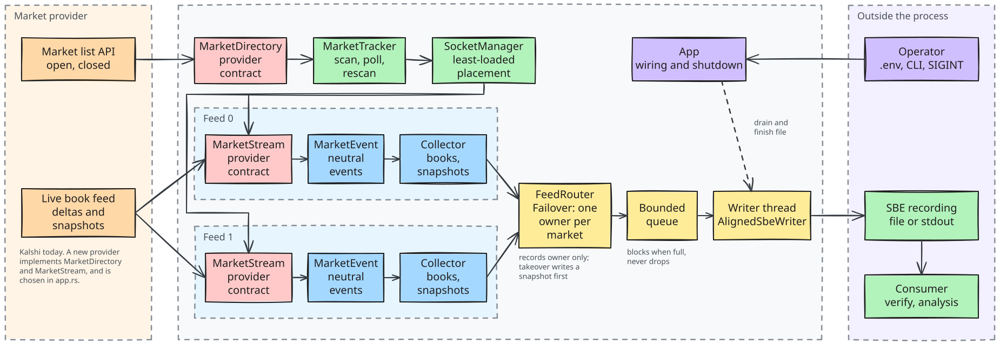

# Kalshi order book collector

This repository contains a Rust service that records the order books of live, non-multivariate Kalshi markets. The service discovers markets over REST, spreads their subscriptions across WebSocket connections, maintains one book per market, and writes every book change in FIX SBE. It also writes a full snapshot of each live book about once a minute, so that a consumer can recover state without replaying the whole file. The sections below describe the data path, the rules that decide when a book is trusted, the reasoning behind the main design choices, and the results obtained against production Kalshi. Instructions for building and running the service are in [CONTRIBUTIONS.md](CONTRIBUTIONS.md).

## Data path



`MarketTracker` pages through Kalshi's market list and passes each page on as it arrives, because a full scan takes many minutes. Once the scan ends, it polls every 30 seconds for markets that opened, closed or settled, and repeats the full scan hourly. It also tracks listed markets that have not opened, and follows each at its opening time. `SocketManager` places each market on the least-loaded socket and opens another socket when every existing one is full. A feed never opens more than its share of the provider's connection limit. Past that point sockets go over their target size, because coverage matters more than an even spread. A socket task that panics is restarted with its markets at the next poll.

Each `KalshiStream` owns one signed WebSocket connection. It reconnects after a failure, with a delay that grows while connections keep failing, and replaces a healthy connection every six hours. Incoming frames pass to `Normaliser`, which checks sequence numbers and converts Kalshi's format into exchange-neutral events. Kalshi quotes YES and NO bids, so a NO bid at price *p* is recorded as a sell at 1 − *p*.

`Collector` applies those events to the books held for its socket. Its output travels through a bounded queue to a single writer thread, which encodes records with the supplied `AlignedSbeWriter`. On SIGINT or SIGTERM the service closes its sockets, drains the queue and finishes the file.

## Redundancy

Every market runs on two independent feeds by default, each with its own sockets and its own book, so a lost socket does not leave a market without a live copy. `Failover` sits between the feeds and the output queue and merges them. Kalshi's exchange clock is the same on every connection, so it identifies each change. The first feed to deliver a change is recorded, later copies are discarded, and a stalled connection therefore costs nothing while another feed keeps up. Receipt times are also the earliest seen. One feed owns each market and supplies its minute snapshots. When an owner's connection ends or its book loses continuity, it gives up the market, and the next feed to produce an event takes over by recording a full snapshot of its book, with its deltas following, so a consumer never receives deltas against a book it has not seen. A standby's snapshot is recorded only when it is ahead of the record. A clock that falls, which happens only during exchange maintenance, starts the market again from a snapshot. `--feeds` sets the number of copies, and each copy adds its own sockets and traffic.

## Adding a provider

`src/provider.rs` holds the contracts that separate the core from any exchange. `MarketDirectory` lists markets and what changed, `MarketStream` runs one connection that feeds books, and `FeedHandler` receives what a stream produces. `SocketManager`, `MarketTracker`, `Collector`, `Failover`, `FeedRouter` and the output depend only on these and on exchange-neutral domain types. A new provider implements the two traits in its own module and is chosen in `app.rs`. `tests/provider.rs` runs a fake provider through the real tracker and manager to hold that boundary in place.

## When a book is trusted

A market starts in the awaiting-snapshot state, in which nothing is published. The first snapshot makes its book live, and only a live book produces deltas and minute snapshots. Removing a market retires it, so that frames already in flight are not mistaken for corruption.

A live book returns to awaiting a snapshot if a sequence gap appears, a frame cannot be read, a delta contradicts the book, or the book stays crossed for more than five seconds. The collector then requests a replacement. Should replacements stop arriving for every market on a socket, a decision `ResyncWatch` makes, the connection is rebuilt, since sequence numbers carry meaning only within one connection. A single overdue market is retried without disturbing its neighbours. The output format has no gap record, so a consumer sees a pause for that market followed by a fresh snapshot.

## Design decisions

The collector for each socket owns that socket's books. A lost message can only affect the books on its own connection, which means recovery requires no state shared between sockets.

Publishing stops as soon as continuity is uncertain. This accepts a pause in the record to avoid recording a book that may be wrong, and the choice follows from the purpose of the data, which is later analysis of what the market actually showed.

Markets are removed when Kalshi lists them as closed or settled. An hourly full scan catches anything the polls missed. Only a complete scan of plausible size may remove a market, and only one placed before that scan began, so neither a failed scan nor an exchange fault can look like markets disappearing.

The output queue blocks when full, so records are never discarded silently. The cost is that a stalled writer delays socket reads and therefore receipt times. Receipt time is taken once per frame before parsing, and each record carries both that time and the exchange time. Kalshi documents its timestamps as optional, so a delta without one uses the message's sending time, and the local time if that is missing too. Each socket starts its minute snapshots at a random offset, so that sockets do not all pause reading together. Order is guaranteed within a market and is not promised across markets.

The supplied reader accepts only 64 MiB chunks, so the writer emits whole chunks. A consumer of stdout therefore receives records a chunk at a time, not as each change happens, and the final partial chunk arrives at shutdown. Receipt times are taken before this buffering, so the delay does not affect what is recorded.

The REST client refuses redirects and insecure URLs, because a redirect would carry signed headers to another host.

## Usage

The program needs Rust and a Kalshi API key. Copy the example environment file, then set your key ID, private key path and the Kalshi URLs in `.env`:

```bash
cp .env.example .env
```

Install the program, which puts `engineering-challenge` on your PATH through `~/.cargo/bin`, then confirm that Kalshi accepts the key:

```bash
make install
```

```bash
engineering-challenge check
```

`make help` lists the Make targets and the program's help. Each command also has its own help:

```bash
engineering-challenge --help
```

```bash
engineering-challenge collect --help
```

### Recording

`collect` records all open markets until stopped with Ctrl-C, SIGINT or SIGTERM. It then closes its sockets, drains its queue and finishes the file.

Record to a file:

```bash
engineering-challenge collect --output out.sbe
```

Record to stdout, the default, with logs kept separate on stderr:

```bash
engineering-challenge collect > out.sbe 2> collect.log
```

Try a small recording first:

```bash
engineering-challenge collect --max-markets 100 --output small.sbe
```

Run a single feed, without redundancy, to halve sockets and traffic:

```bash
engineering-challenge collect --feeds 1 --output out.sbe
```

Use smaller sockets, so that each lost connection affects fewer markets:

```bash
engineering-challenge collect --markets-per-socket 1000 --output out.sbe
```

### Inspecting

`verify` decodes every record in a file and reports the number of snapshots, updates and distinct markets. It needs no credentials:

```bash
engineering-challenge verify out.sbe
```

`discover` scans the market list and reports how many markets are open, with a sample:

```bash
engineering-challenge discover
```

`watch` follows one market and logs its best bid and ask. Replace the ticker with a real one from `discover`:

```bash
engineering-challenge watch MARKET-TICKER
```

Set `RUST_LOG` for more detail, such as REST page timings:

```bash
RUST_LOG=info,engineering_challenge::kalshi::rest=debug engineering-challenge discover
```

### Make targets

`make smoke` is the quickest end-to-end check. It records 100 markets for a minute and decodes the result:

```bash
make smoke
```

Run every local check, the same as CI:

```bash
make check
```

Repeat the whole evaluation, which takes about an hour, then print its tables:

```bash
make experiments
```

```bash
make summary
```

The experiments can also run one at a time with `make baseline`, `make socket-size`, `make backlog` and `make link`. The last two use macOS tools. Logs go to `results/`, and `make clean-results` deletes them.

## Why a command-line program

The collector is a long-running process whose product is a recording. The challenge asks for output on stdout and for shutdown on SIGINT, and both are native to a command-line program, which also composes with pipes, process supervisors and containers without further code. An HTTP API would suit a system that answers requests, but nothing here queries the collector while it runs. Adding one would bring a server, an authentication surface and a second way of stopping the process, with no consumer to justify them. The subcommands call `App`, so an API could later sit on the same core if a consumer appears.

## Module guide

| Module | Responsibility |
|---|---|
| `provider.rs` | The contracts every provider implements |
| `discovery.rs` | Which markets to follow |
| `manager.rs` | Which socket holds each market |
| `resync.rs` | What to do about unanswered snapshot requests |
| `router.rs` | One feed's route to the writer |
| `kalshi/rest.rs`, `kalshi/auth.rs`, `kalshi/directory.rs` | HTTP, retries, Ed25519 signing and the market list |
| `kalshi/stream.rs`, `kalshi/session.rs` | The life and timers of a connection, and its state |
| `kalshi/wire.rs`, `kalshi/normalise.rs` | Kalshi's message format |
| `domain.rs`, `collector.rs` | Exchange-neutral book rules |
| `failover.rs` | Which feed is recorded for each market |
| `output.rs` | SBE mapping and the single writer |
| `transport.rs` | Backoff, jitter and URL safety |
| `app.rs`, `types.rs` | Wiring, configuration and shutdown |

## Evaluation

The evaluation asks whether the service records Kalshi books correctly at scale, and what limits how many markets it can follow.

### Method

All runs used one Mac on a home connection against production Kalshi on 5 November 2026. Each run started with no state and stopped on SIGINT. A baseline run scanned markets with no sockets open. Size runs varied markets per socket. A backlog run sampled throughput, unread socket bytes and CPU every 10 to 15 seconds. A link run measured the connection with `networkQuality` while idle and again during collection. A connection loss is any connection that ended and was replaced. A market is placed once it is handed to a socket. All runs used a single feed. Every experiment can be repeated with `make experiments`, and `make summary` prints these tables from the logs. [CONTRIBUTIONS.md](CONTRIBUTIONS.md) describes the targets.

### Results

**Table 1.** Markets placed and connection losses by run.

| Run | Duration (min) | Markets per socket | Markets placed | Losses |
|---|---|---|---|---|
| Long | 50 | 2,000 | 51,000 | 65 |
| Size | 15 | 2,000 | 71,000 | 16 |
| Size | 15 | 500 | 69,000 | 14 |
| Backlog | 22 | 1,000 | 88,000 | 34 |
| Link | 15 | 1,000 | 60,000 | 18 |

**Table 2.** Connection losses by cause.

| Run | Reset | Server closed | Snapshots unanswered | Silence |
|---|---|---|---|---|
| Long | 62 | 2 | 1 | 0 |
| Size, 2,000 | 10 | 3 | 3 | 0 |
| Size, 500 | 9 | 5 | 0 | 0 |
| Backlog | 25 | 7 | 2 | 0 |
| Link | 9 | 2 | 3 | 4 |

**Table 3.** Mean page time in seconds by position in the scan.

| Pages | No sockets | 2,000 per socket | 500 per socket |
|---|---|---|---|
| 1 to 20 | 7.4 | 7.7 | 6.2 |
| 21 to 42 | 6.7 | 9.8 | 10.9 |
| 43 onwards | no data | 17.6 | 19.1 |

**Table 4.** Link measurements with `networkQuality`.

| Measure | Idle | During collection |
|---|---|---|
| Download (Mbit/s) | 27.0 | 28.4 |
| Download responsiveness (ms) | 331 | 613 |
| Upload responsiveness (ms) | 724 | 1,276 |
| Idle latency (ms) | 17 | 40 |

The long run recorded 960 MiB, including 1,593,029 snapshots, all decoded by the supplied reader, with memory at or below 140 MB. In the backlog run, CPU averaged 10.5% of one core and peaked at 27.5%, traffic reached at least 25 Mbit/s, and unread socket bytes were zero in 88 of 90 samples. No REST request was retried in any timed run. Every lost connection was replaced, and every run exited cleanly.

### Discussion

The service recorded and decoded data correctly at tens of thousands of markets, but no run with sockets open completed a scan of the roughly 180,000 markets, so full coverage remains undemonstrated. Page times rose as runs progressed, while socket size had no visible effect on page time or total losses. The near-zero backlog suggests the reader keeps up. Peak traffic close to the measured download figure is consistent with link congestion, which is the leading explanation but was not isolated.

These results come from a single machine, network and day, and most configurations ran once. The two runs at 2,000 markets per socket differed by about six times in scan speed, so small differences between runs should not be interpreted. Market count, page depth and elapsed time rose together and were not separated. The figures are from an earlier run and will be re-run, and a repeat from a well-connected machine is the next step.

The automated tests in `tests/` cover book rules, recovery, failover, routing, the provider contracts, normalising, discovery and output.
